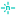

# Glance Icons

Colourful file and folder icons for IntelliJ IDEA, WebStorm and every other JetBrains IDE. They make the project tree easier to scan, and they understand Angular, up to Angular 22's `@Service()` and the 2025 style guide where `ng generate` no longer puts `.component` or `.service` in file names.

- 92 file icons and 25 folder icons, with dark-theme variants where a logo needs one
- **One icon per Angular type:** component, service, directive, pipe, guard, interceptor, routes, module, store and model each have their own drawing, found by file name *or* by the decorator inside the file
- Folders and files never share an icon: the `components` folder looks different from the components in it
- Official logos for languages, frameworks and tools, and config files that show the tool they configure
- Java and Kotlin test classes get a test badge, in the project tree too
- Each image format has its own icon: SVG, PNG, JPG, GIF, WebP and favicons
- Source roots, content roots and excluded folders keep the IDE's own icons, so you don't lose that information
- Free and open source (MIT)

Open [`docs/preview.html`](docs/preview.html) in a browser to see every icon in a light and a dark project tree.

## Angular

| Icon | Used for |
| --- | --- |
|  | Components: `*.component.ts`, or any `.ts` file with `@Component(…)` |
|  | Services: `*.service.ts`, `@Service()` (Angular 22) or `@Injectable(…)` |
|  | Directives: `*.directive.ts` or `@Directive(…)` |
|  | Pipes: `*.pipe.ts`, `*-pipe.ts` or `@Pipe(…)` |
|  | Guards: `*.guard.ts`, `*-guard.ts`, `CanActivateFn` and friends, or `implements CanActivate` |
|  | Interceptors: `*.interceptor.ts`, `*-interceptor.ts`, `HttpInterceptorFn` or `implements HttpInterceptor` |
|  | Routes and resolvers: `*.routes.ts`, `app.routes.server.ts`, `*-routing-module.ts`, `*-resolver.ts`, `ResolveFn` |
|  | Modules: `*.module.ts`, `*-module.ts` or `@NgModule(…)` |
|  | State (NgRx logo): `*.store.ts`, NgRx files, `signalStore(…)`, `createReducer(…)` |
|  | Models and data: `*.model.ts`, `*.interface.ts`, `*.types.ts`, `*.enum.ts`, `*.dto.ts`, `*.data.ts` |
|  | Specs: `*.spec.ts`, `*.test.ts`, `*.cy.ts` and the JS/TSX equivalents |
|  | Stories: `*.stories.ts` |
|  | Environments: `environment.ts`, `environment.*.ts`, `.env*` |
|  | App config: `app.config.ts`, `app.config.server.ts` |
|  | `angular.json` |

Since Angular 20, `ng generate` names components, directives and services without a type suffix (`user-card.ts`), and joins the other suffixes with a hyphen (`auth-guard.ts`). File names alone can't tell those apart, so the plugin reads the decorator. The result is cached per file and refreshed when you save.

## Languages and frameworks

| Icon | Used for |
| --- | --- |
|  | `.ts`, `.mts`, `.cts` |
|  | `.js`, `.mjs`, `.cjs` |
|  | `.tsx`, `.jsx` |
|  | `next.config.*`, `next-env.d.ts` |
|  | `.vue` |
|  | `.svelte` |
|  | `.html`, `.htm` |
|  | `.css`, `.less` |
|  | `.scss`, `.sass` |
|  | `.json`, `.jsonc`, `.json5` |
|  | `.yml`, `.yaml` |
|  | `.md`, `.mdx` |
|  | `.graphql`, `.gql` |
|  | `.py`, `requirements.txt`, `pyproject.toml`, `Pipfile` |
|  | `.ipynb` |
|  | `.java`, `.jar`, `.class` |
|  | `*Test.java`, `*Tests.java`, `*IT.java` |
|  | `.kt`, `.kts` (Gradle scripts keep their Gradle icon) |
|  | `*Test.kt`, `*Tests.kt`, `*IT.kt` |
|  | `.rs`, `Cargo.toml` |
|  | `.go` |
|  | `go.mod`, `go.sum`, `go.work` |
|  | `.swift` |
|  | `.dart` |
|  | `.php` |
|  | `.rb`, `Gemfile`, `Rakefile` |
|  | `.c`, `.h` |
|  | `.cpp`, `.cc`, `.hpp` |
|  | `.cs`, `.fs`, `.csproj`, `.sln` |
|  | `.lua` |
|  | `.sh`, `.bash`, `.zsh`, `.fish` |

Java and Kotlin files that hold a single class show up in the project tree as that class. The plugin puts the language icon on those class nodes too, which replaces IntelliJ's class, interface and enum markers there.

## Tools and config files

| Icon | Used for |
| --- | --- |
|  | `tsconfig*.json` |
|  | `eslint.config.*`, `.eslintrc*` |
|  | `.prettierrc*`, `prettier.config.*` |
|  | `vite.config.*` |
|  | `vitest.config.*` |
|  | `jest.config.*` |
|  | `cypress.config.*` |
|  | `tailwind.config.*` |
|  | `webpack.*` |
|  | `.babelrc`, `babel.config.*` |
|  | `*.stories.*` |
|  | `nx.json`, `project.json` |
|  | `nest-cli.json` |
|  | `.prisma` |
|  | `package-lock.json`, `.npmrc` |
|  | `yarn.lock`, `.yarnrc.yml` |
|  | `pnpm-lock.yaml`, `pnpm-workspace.yaml` |
|  | `bun.lock`, `bunfig.toml` |
|  | `.nvmrc`, `.node-version` |
|  | `.editorconfig` |
|  | everything else: `config.json`, `*.config.ts`, `proxy.conf.json`, `karma.conf.js` |

## Project files and hosting

| Icon | Used for |
| --- | --- |
|  | `package.json` |
|  | other lock files: `*.lock`, `gradle.lockfile` |
|  | `.gitignore`, `.gitattributes` |
|  | workflows in `.github/workflows/` |
|  | `.gitlab-ci.yml` |
|  | `Dockerfile`, `docker-compose.yml`, `compose.yaml` |
|  | `firebase.json`, `.firebaserc`, `firestore.rules` |
|  | `vercel.json` |
|  | `netlify.toml` |
|  | `README*` |
|  | `LICENSE*` |
|  | `CHANGELOG*` |

## Media and documents

| Icon | Used for |
| --- | --- |
|  | `.svg` |
|  | `.png` |
|  | `.jpg`, `.jpeg` |
|  | `.gif` |
|  | `.webp` |
|  | `.ico` |
|  | `.avif`, `.bmp`, `.tiff`, `.heic` |
|  | `.mp4`, `.mov`, `.webm` |
|  | `.mp3`, `.wav`, `.ogg` |
|  | `.woff`, `.woff2`, `.ttf`, `.otf` |
|  | `.zip`, `.tar.gz`, `.7z`, `.rar` |
|  | `.pdf` |
|  | `.docx`, `.odt`, `.rtf` |
|  | `.pptx`, `.key`, `.odp` |
|  | `.csv`, `.xlsx`, `.ods` |

## Folders

| Icon | Folder names |
| --- | --- |
|  | `app` |
|  | `src`, `source` |
|  | `core` |
|  | `frontend`, `client`, `web` |
|  | `backend`, `server`, `srv` |
|  | `components`, `ui`, `widgets` |
|  | `services`, `api` |
|  | `directives` (Angular logo) |
|  | `pipes` (Angular logo) |
|  | `guards` (Angular logo) |
|  | `interceptors` (Angular logo) |
|  | `store`, `state`, `ngrx` |
|  | `models`, `types`, `interfaces`, `entities` |
|  | `shared`, `common` |
|  | `utils`, `helpers`, `lib` |
|  | `pages`, `views`, `features`, `layout` |
|  | `assets`, `public`, `static`, `images`, `fonts`, `svgs` |
|  | `styles`, `scss`, `theme` |
|  | `test`, `tests`, `e2e`, `cypress` |
|  | `docs` |
|  | `scripts`, `bin`, `tools` |
|  | `config`, `environments`, `settings`, `.vscode` |
|  | `.git`, `.github`, `.gitlab`, `.husky` |
|  | `node_modules`, `packages`, `libs`, `vendor` |
|  | `i18n`, `locale`, `translations` |

The full matching rules live in [`IconRules.kt`](src/main/kotlin/io/github/shangotek/glanceicons/IconRules.kt) and [`AngularFiles.kt`](src/main/kotlin/io/github/shangotek/glanceicons/AngularFiles.kt) and [`FileIcons.kt`](src/main/kotlin/io/github/shangotek/glanceicons/FileIcons.kt).

## Build and run

You need JDK 25 (Gradle downloads everything else). The plugin is compiled to Java 21 bytecode, so it runs in every JetBrains IDE from 2025.1 on.

```bash
./gradlew runIde                                # start a sandbox IDE with the plugin installed
./gradlew test                                  # unit tests and headless IDE tests (IDEA 2026.2.3)
./gradlew test -PplatformVersion=2025.1.7.2     # the same tests in the oldest supported IDE
./gradlew buildPlugin                           # build/distributions/glance-icons-<version>.zip
./gradlew verifyPlugin                          # check compatibility against recommended IDE versions
```

To install the zip in your own IDE, open **Settings → Plugins → ⚙ → Install Plugin from Disk…**.

## Publishing on the JetBrains Marketplace

The Marketplace hosts free plugins at no cost.

1. Sign in at [plugins.jetbrains.com](https://plugins.jetbrains.com) with a JetBrains account.
2. Choose **Upload plugin**, select the zip from `build/distributions`, pick a license (MIT) and the *Free* option.
3. JetBrains reviews the first upload, which usually takes a few working days. After that, people find it under **Settings → Plugins → Marketplace**.

Pick the plugin ID in `plugin.xml` before the first upload: it can't change afterwards. For later releases you can create a Marketplace token and publish with `./gradlew publishPlugin`.

## Adding an icon

1. Save a 16×16 SVG to `src/main/resources/icons/files/` (or `folders/`). Keep the colours mid-tone so the icon works in both themes, or add a `<name>_dark.svg` that IntelliJ picks up in dark themes.
2. Add an entry with the same name, in upper case, to `FileIcon` or `FolderIcon` in [`GlanceIcons.kt`](src/main/kotlin/io/github/shangotek/glanceicons/GlanceIcons.kt).
3. Map file names to it in [`IconRules.kt`](src/main/kotlin/io/github/shangotek/glanceicons/IconRules.kt) and add a case to `IconRulesTest`.
4. Run `./gradlew test`. The tests fail if an entry has no SVG.

## Credits and license

The plugin code and the original icons are released under the [MIT license](LICENSE).

- Brand logos come from [Simple Icons](https://simpleicons.org), released under CC0.
- The Go gopher and EditorConfig icons come from [Material Icon Theme](https://github.com/material-extensions/vscode-material-icon-theme) (MIT). The Go gopher was designed by Renée French (CC BY 4.0).
- The Java icon is an original coffee cup with flame-shaped steam, because the official Java logo isn't freely licensed.

Brand logos are trademarks of their owners and are used only to identify file types. Full license texts are in [THIRD-PARTY-NOTICES.md](THIRD-PARTY-NOTICES.md), which also ships inside the plugin.
